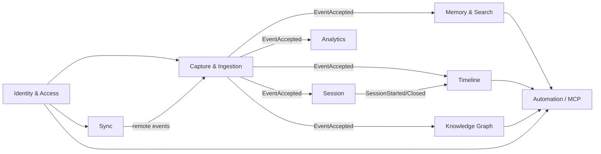

# Bounded Contexts

Detailed view of Chronicle’s DDD bounded contexts. Companion to [ARCHITECTURE.md](../../ARCHITECTURE.md).

## Context map

## Context catalog

### Identity & Access

- **Responsibility:** actors, devices, API credentials, workspace membership, consent grants
- **Aggregates:** `Workspace`, `Device`, `Credential`, `ConsentGrant`
- **Upstream of:** all contexts requiring authz

### Capture & Ingestion

- **Responsibility:** validate envelopes, redact, append, outbox
- **Aggregates / services:** `IngestBatch`, event append service
- **Inbound:** extensions, desktop, sync push, manual API

### Session

- **Responsibility:** deterministic session open/close/assign (ADR-0011)
- **Aggregates:** `Session`
- **Output:** session lifecycle domain events for timeline/analytics

### Timeline

- **Responsibility:** ordered replay read models
- **Read models:** `TimelineItem`, replay cursors
- **Consumers:** web, desktop, MCP

### Memory & Search

- **Responsibility:** chunking, embeddings, hybrid retrieval
- **Aggregates / models:** `MemoryIndex`, `MemoryChunk`, `Embedding`
- **Dependencies:** EmbeddingPort, pgvector

### Knowledge Graph

- **Responsibility:** entity/relationship projection with evidence
- **Models:** `GraphNode`, `GraphEdge`, `GraphEvidence`
- **Rebuildable:** yes (ADR-0019)

### Analytics

- **Responsibility:** aggregated metrics windows (focus, switches, review load)
- **Models:** `MetricWindow`
- **Note:** not a surveillance score; developer-facing insights

### Sync

- **Responsibility:** cursors, push/pull, conflict records (ADR-0018)
- **Models:** `SyncCursor`, `ConflictRecord`

### Automation / MCP

- **Responsibility:** tool invocations with redaction and audit (ADR-0017)
- **Models:** `ToolInvocation` audit records

## Anti-corruption notes

- Git host PR JSON is translated into Chronicle events at the edge; raw vendor payloads are not the domain language.
- Editor-specific event names map into canonical `type` strings in `packages/schemas`.
- MCP clients see DTOs, never SQL rows.
