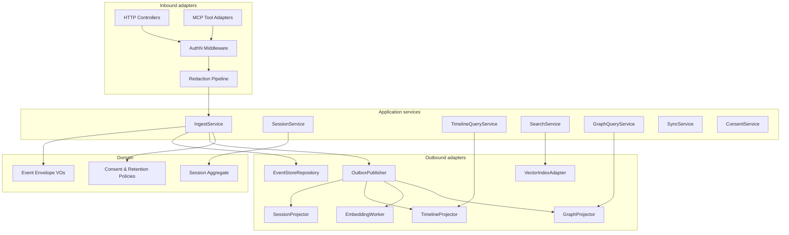

# Component Diagram

C4 Level 3 — API and worker internals (logical components).

## Hexagonal mapping

| Port (example) | Adapter |
| --- | --- |
| `EventStorePort` | SQLAlchemy PostgreSQL repository |
| `ClockPort` | System UTC clock / test clock |
| `EmbeddingPort` | Local model runner |
| `SearchPort` | pgvector query adapter |
| `JobEnqueuePort` | Outbox + Celery |
| `SecretRedactorPort` | Regex/heuristic redactor |

Domain components do not import FastAPI, Celery, or SQLAlchemy.
