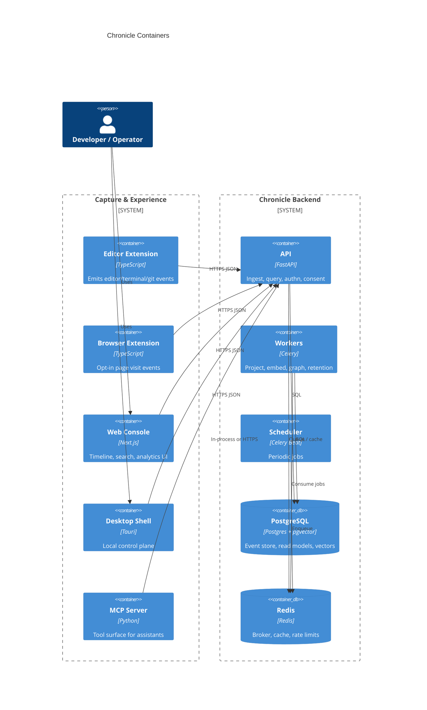

# Container Diagram

C4 Level 2 — runnable containers in the reference deployment.

## Container responsibilities

| Container | Writes | Reads |
| --- | --- | --- |
| API | Event log, outbox, auth artifacts | Read models for queries |
| Workers | Projections, embeddings, graph, analytics | Event log, outbox |
| Scheduler | Job schedules via broker | Configuration |
| PostgreSQL | Durable state | — |
| Redis | Ephemeral broker/cache state | — |

Clients never receive database credentials.
