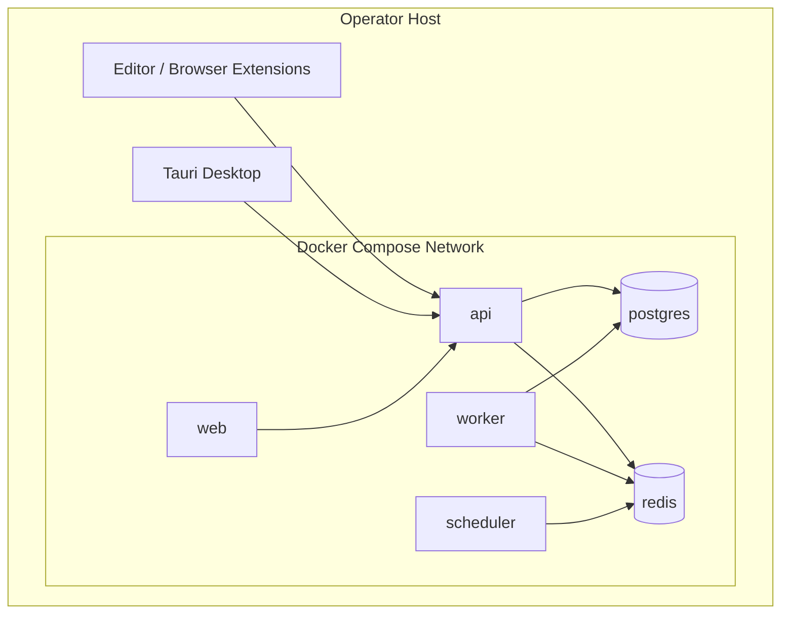
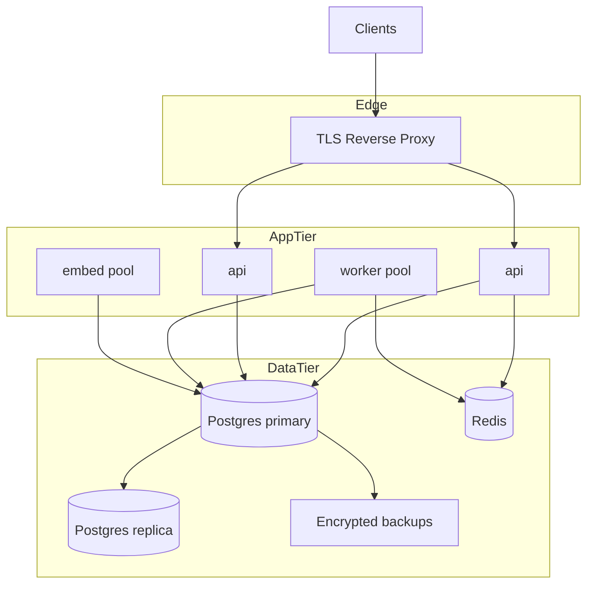

# Deployment Diagram

Reference topologies from laptop to hardened single-site.

## Local development / single-node

## Hardened single-site

## Deployment principles

1. API is horizontally scalable behind a load balancer.
2. Workers scale independently; embed workers may use GPU hosts.
3. Postgres primary is the write authority; replicas serve heavy read/search when configured.
4. Redis is not a durable system of record.
5. Backups encrypt event payloads at rest in backup storage.

See [../deployment/scaling.md](../deployment/scaling.md) and [../deployment/disaster-recovery.md](../deployment/disaster-recovery.md).
