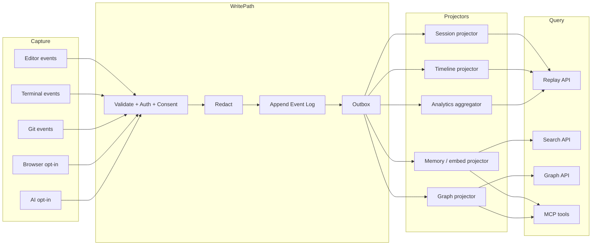

# Event Flow Diagram

Steady-state path from capture to queryable memory.

## Ordering guarantees

| Concern | Guarantee |
| --- | --- |
| Persist order per workspace | Append transaction order + `received_at` |
| Producer time | `occurred_at` retained; may be skewed |
| Projection order | By event store offset / monotonic id |
| Cross-device | Converges after sync; temporary divergence allowed |

## Backpressure

When embed or graph queues exceed configured depth, ingest continues by default (durability first). Operators may enable degrade modes that reject non-critical event types—documented in deployment runbooks.
