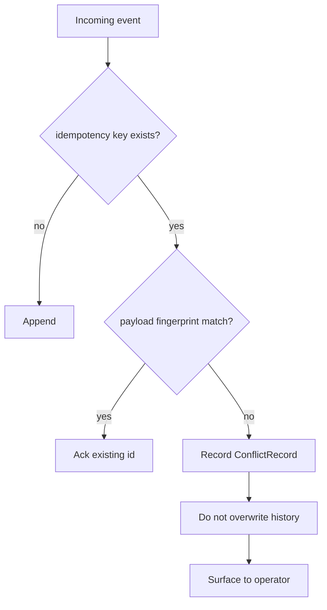

# Multi-Device Sync Sequence

```mermaid
sequenceDiagram
    autonumber
    participant D1 as Device A API
    participant Hub as Sync Peer / Primary
    participant D2 as Device B API

    Note over D1,D2: Both append locally; sync converges on event log

    D1->>Hub: POST /v1/sync/push (events since cursor)
    Hub->>Hub: Validate auth, idempotency, consent policy
    Hub->>Hub: Append missing events
    Hub-->>D1: Accepted ids + conflicts

    D2->>Hub: POST /v1/sync/pull (cursor)
    Hub-->>D2: Event batch + next_cursor
    D2->>D2: Append locally (idempotent)
    D2->>D2: Advance projectors

    D1->>Hub: POST /v1/sync/pull
    Hub-->>D1: Events originating from B
    D1->>D1: Advance projectors
```

## Conflict handling



Sync never mutates previously accepted event payloads. Conflicts require explicit operator resolution workflows (emit compensating events if needed).
