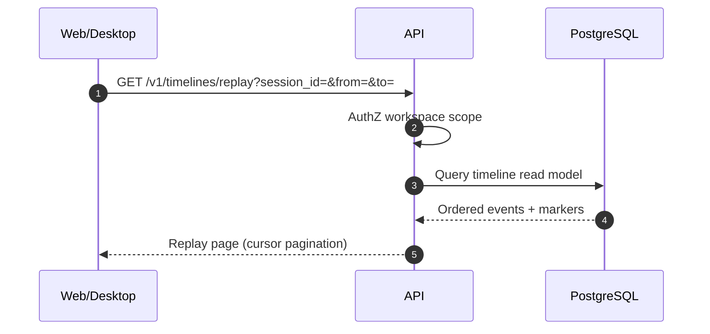
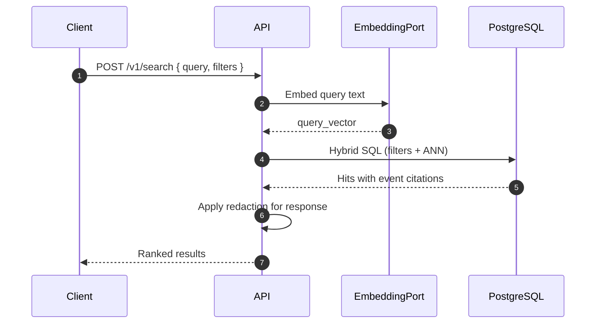

# Sequence Diagrams

## Ingest acknowledgement

```mermaid
sequenceDiagram
    autonumber
    participant Ext as Capture Client
    participant API as API
    participant Red as Redactor
    participant DB as PostgreSQL
    participant Pub as Outbox Publisher
    participant W as Worker

    Ext->>API: POST /v1/events (idempotency key)
    API->>API: Authenticate + authorize + consent check
    API->>Red: Redact sensitive fields
    Red-->>API: Sanitized envelope
    API->>DB: BEGIN; INSERT event; INSERT outbox; COMMIT
    alt duplicate idempotency key
        DB-->>API: Existing event
        API-->>Ext: 200 + event_id
    else new event
        API-->>Ext: 201 + event_id
        Pub->>DB: Claim outbox row
        Pub->>W: Enqueue project_event
        W->>DB: Project session/timeline/memory/graph
    end
```

## Timeline replay query



## Semantic search



Related: [sequence-sync.md](sequence-sync.md), [event-flow.md](event-flow.md).
