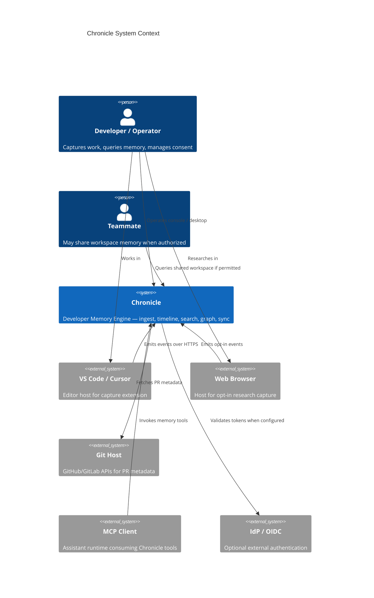

# System Context Diagram

C4 Level 1 — Chronicle and its actors.

## Narrative

Developers interact with Chronicle through capture surfaces and the web/desktop consoles. All durable facts enter Chronicle as Events. External systems never write Timeline, Memory, or Knowledge Graph projections directly.

## Trust summary

| Boundary | Trust note |
| --- | --- |
| Extension → API | Authenticated; consent-gated categories |
| Browser → API | Opt-in; redaction applied |
| MCP → API | Scoped tools; redaction + audit |
| API → Git host | Outbound credentials stored as secrets |
| Operator → data plane | Full control on self-hosted deployments |

See also: [containers.md](containers.md), [../security/threat-model.md](../security/threat-model.md).
