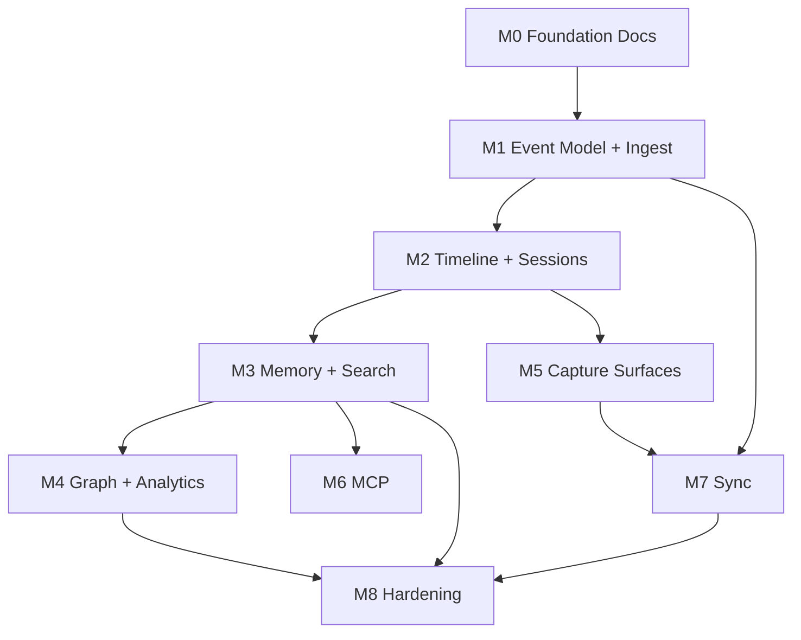

# Roadmap Detail

Expands [ROADMAP.md](../../ROADMAP.md) with dependency notes and documentation deliverables.

## Milestone dependency graph

## Documentation expectations per milestone

| Milestone | Docs due with code |
| --- | --- |
| M1 | OpenAPI snapshot, event schema catalog |
| M2 | Replay API examples, session algorithm version note |
| M3 | Search tuning guide, benchmark results |
| M4 | Graph query cookbook |
| M5 | Extension install + consent UX screenshots (synthetic) |
| M6 | MCP tool schema + residual risk |
| M7 | Sync runbook + conflict ops |
| M8 | DR drill report template filled once |

## Six-month narrative (planning)

| Month | Focus |
| --- | --- |
| 1 | Repository setup, documentation, architecture |
| 2 | Core domain, database |
| 3 | Backend APIs |
| 4 | Frontend, desktop foundations |
| 5 | Extensions, search engine |
| 6 | Optimization, docs polish, CI/CD, RC |

This matches the root roadmap and informs historical contribution planning.

Post-RC work prioritizes Postgres-backed event store adapters without changing domain ports.

